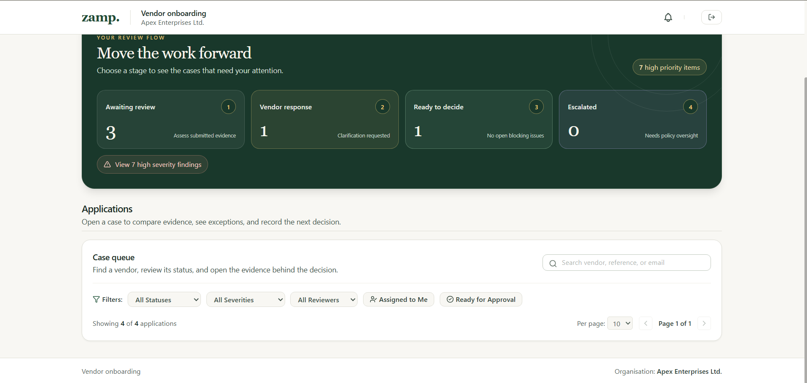
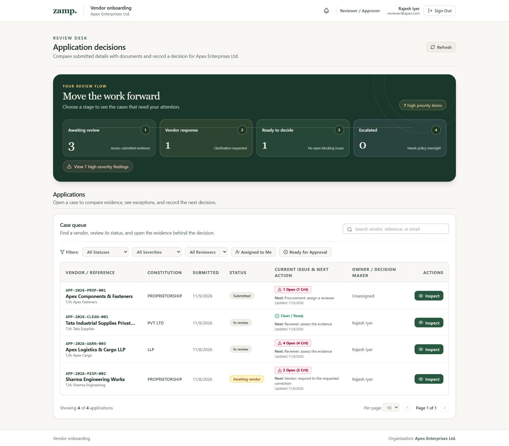

# Zamp vendor onboarding | prototype audit and repair plan
**9 November 2026 · review copy · revision 47f748f**

## Decision for the product owner

I would hold evaluator sign-off. In the affected Chrome window a reviewer can see that four suppliers exist but cannot open any of them. Independently, a completed approval can be changed through the ordinary rejection endpoint, and a fresh invitation can change an existing user's password. The first prevents the interview demonstration. The latter two undermine the trustworthiness of the decision process.

I recommend one coordinated release, with the queue, identity and decision fixes verified first, then the clarification journey, then the presentation and evaluator rehearsal. The proposed release requires no paid service.

## What the case study asks us to prove

Page 4 of the candidate guide asks a buyer to judge completeness, consistency and credibility of a vendor submission, receive an explained approved, pending or rejected result, and communicate the next requirement. Pages 2–3 also require a live process, visible stages, history and outputs. The five-minute recording must show a happy path and an edge case. This makes an unexplained pending case as much a product failure as a broken button. The rubric gives 44 points to the working process and safe decisions, 16 to edge cases, 25 to visibility and history, and 15 to UI, judgment and demo collectively. [Candidate guide](../ASA%20Case%20Study%20%E2%80%94%20Candidate%20Guide.pdf) · [Existing rubric](../PROTOTYPE_GRADING_RUBRIC.md)

## Scope and confidence

I inventoried tracked Python, TypeScript, UI styles, scripts, deployment and test/configuration files, and parsed tracked Python syntax. I traced the principal user journeys through components, HTTP handlers, response schemas, models and services. The inventory included 116 backend and 54 frontend source/config/test files plus root and test-data tooling under the scanned extensions. That inventory is broader than the hand review. Detailed checks focused on the interaction and decision paths below. Live observations used synthetic demo accounts. State-changing probes used a disposable database copy. Evidence labels below distinguish observations, deterministic source defects, conditional risks and design recommendations. This is not a certification of every dependency, registry rule, browser, or India-specific legal obligation.

## Incident Q1 — four records, zero visible cases

1. **Affected session.** All status, severity and reviewer filters are unrestricted, search is empty and page size is ten. The screenshot shows the footer immediately after the filters. Inspection of the user's open Google Chrome reviewer window also finds no table, vendor names, or case-opening actions in the accessibility tree. The administrator has the same reported symptom and uses the same queue component.
2. **Control sessions.** On the same hosted site both roles received HTTP 200 with four distinct items and total four. In fresh Chromium sessions both roles exposed four case actions at CSS widths 390, 767, 768, 1024 and 1440. A new profile using the installed Google Chrome 150 at 1536 CSS pixels and 1.25 device scale also rendered four reviewer rows. The cases in that capture are Apex Components, Tata Industrial Supplies, Apex Logistics and Sharma Engineering Works.
3. **Code boundary.** The footer uses the actual array length for its first four. The queue currently renders the same items twice. At the medium breakpoint the desktop table switches from hidden to block and the mobile cards switch from block to hidden. In the control these rules switched correctly at 768px. My earlier mobile check verified the cards but missed this laptop regression. The specific winning CSS rule or runtime difference in the affected tab remains unverified. Cache, zoom and extensions are diagnostic variables, not established causes. A second defect, Q2 below, explains missing issue detail but cannot explain disappearing vendor names.
4. **Recommended fix.** Preserve this screenshot as a regression fixture. Before changing CSS, inspect both wrappers in the affected profile, their computed display and ancestors, loaded asset versions, active media queries and DOM row count. Record which rule or missing element accounts for the difference. Then render one accessible collection of cases, with a supplier-name link and next action per item, and reflow the fields for phones. Give the collection a visible default layout. Use CSS for arrangement without hiding the entire only route to a decision.
5. **Pass condition.** With the same four records, both roles expose four visible vendor names and four keyboard-operable case links on the user's laptop as well as a fresh profile. Open each case and match its reference. Repeat at 320px, the 767/768 boundary, laptop width and 200% zoom. Exercise empty results, errors, loading and pagination. A reported success must include the affected profile. [Chrome CSS inspection](https://developer.chrome.com/docs/devtools/css/reference/) · [Tailwind responsive rules](https://tailwindcss.com/docs/responsive-design) · [W3C reflow guidance](https://www.w3.org/WAI/WCAG22/Understanding/reflow.html)

**Observed failure on the user's laptop**

**Same site, fresh Chrome profile**

## Findings and proposed acceptance checks

**Release blockers** affect the ability to open, trust or defend a decision. **High** issues affect an ordinary stakeholder journey or create a material conditional risk. **Medium** issues affect comprehension, resilience or the quality of the demonstration. Source locations are relative to the repository. Each proposed check belongs to the later implementation phase.

### Identity, decisions and evidence

| ID / priority | Evidence and consequence | Proposed change and proof |
|---|---|---|
| I1 · Blocker | **Locally reproduced.** The invitation creator receives a usable invite link. Accepting a link for an existing email rewrites that user's password. In the disposable copy invite creation returned 201, acceptance returned 200, the new password authenticated and the original returned 401. The account is global across memberships. See `invitations.py`, create and accept handlers, and `core/deps.py`. | Scope an invite to joining the buyer. Existing users authenticate as themselves before linking a membership. New users use a single-use invite. Refuse conflicting staff membership. Test existing vendor, staff, unrelated organisation, expired, revoked and concurrent acceptance. Password and prior memberships must survive. |
| D1 · Blocker | **Locally reproduced.** Rejecting an approved application returned 200. `decision_service.reject_application` excludes drafts and rejected cases but permits approved ones. Separately `applications.submit_application` explicitly rejects only SUBMITTED before checking form completeness, leaving a path to resubmit a complete case in another state. | Define allowed transitions on the server, bind each write to the expected current revision, and write the decision, notice and audit together. A stale tab or repeat request must preserve the first decision. Cover approved→reject, rejected→submit, repeat submit and simultaneous approve/reject. |
| D2 · Blocker | **Source defect.** `check_approval_eligibility` checks only the first three current failed findings in its fallback loop. An unlinked fourth failure can escape that check. It also accepts a current run without checking completion status, and excludes stale failures. Other gates may still block an individual case. | Evaluate all current material findings and verify completed checks against current evidence versions. Limit the number displayed only after evaluating eligibility. Exercise four failures with only the fourth outstanding, unfinished check, replaced evidence and clean control. |
| D3 · High | **Source risk.** An old resolved exception for the same check ID can satisfy a later failure, even if its evidence changed. An active linked exception can also suppress the fallback while its lower severity leaves it outside the critical/high gate. See `decision_service.py`, linked-exception loop. | Bind each override to a finding, evidence version, reason and authorized actor. Define which failures permit an override. Change the PAN or bank proof after an override and require another decision. |
| D4 · High | **Source defect.** Submitted ownership and decision authority disagree. The queue can direct procurement to assign an owner while the approve endpoint accepts a reviewer in the organisation without checking assignment. Procurement's detail screen passes `isReviewer=true` and can show approval/rejection that its endpoints deny. | Product decision proposed for approval: procurement and admin route work, the assigned reviewer decides, and admin substitution records a reason. Return allowed actions from the server. Verify every role on unassigned, assigned-to-self, assigned-to-other and escalated cases. |
| D5 · High | **Source defect.** A non-fatal exception in the validation call can still lead to a successful submission receipt. The orchestrator marks the new run current while in progress. Exception generation errors are logged and the run can still commit. Files, runs, issues and the human worklist can diverge. See `applications.submit_application`, `orchestrator.run_full_validation`. | Persist “Received / checks incomplete” on processing failure, give operations a retry, and promote a run after its results and action items are complete. Inject a checker failure, then retry. Require one current completed result and an accurate vendor receipt. |
| D6 · High | **Source defect.** Generic PAN and bank adapter fallback branches generate VERIFIED results for plausible inputs and can echo the applicant's own submitted name as the returned name. That supplies circular evidence even when the registry is labelled simulated. See `verification/simulated.py` around 106 and 478. | Use independent synthetic registry fixtures. Return an explicit unknown for plausible IDs absent from the fixture. Keep format validity, provider unavailable and evidence mismatch distinct. Try an unfamiliar but valid-format identifier and a known mismatched holder. |

Approval rules should check both the authorized actor and the data they are approving at the time of the decision. The Oracle supplier flow also provides a relevant product precedent for routing resubmissions and recording the reason communicated to the supplier. The assignment rule above is a proposed product choice. [OWASP transaction authorization](https://cheatsheetseries.owasp.org/cheatsheets/Transaction_Authorization_Cheat_Sheet.html) · [OWASP request authorization](https://cheatsheetseries.owasp.org/cheatsheets/Authorization_Cheat_Sheet.html) · [OWASP account recovery](https://cheatsheetseries.owasp.org/cheatsheets/Forgot_Password_Cheat_Sheet.html) · [Oracle supplier approval actions](https://docs.oracle.com/en/cloud/saas/procurement/26b/oaprc/supplier-registration-approval-actions.html)

### Reviewer, procurement and admin work

| ID / priority | Evidence and consequence | Proposed change and proof |
|---|---|---|
| Q2 · High | **Live and source confirmed.** The queue service adds `blocking_reasons` and `vendor_replied`; `QueueItemResponse` omits both. Both live role responses omitted both keys. A generic next-action string can survive, but the dedicated badge and blocker details cannot. | Publish a typed case summary for all three staff roles with issue title, urgency, next actor, response timestamp, evidence destination and decision eligibility. Assert the actual HTTP response and visible row for a replied case and a zero-open-exceptions case with a current failure. |
| Q3 · High | **Source defect.** Dashboard high priority totals combine HIGH and CRITICAL. The click selects exact HIGH and returns applications, while the label counts issues. The row's “Crit” count also includes HIGH. Admin “Waiting over 3 days” opens all awaiting review. Procurement “Being completed” includes DRAFT in its count but filters IN_PROGRESS on click. | Share each cohort definition between its count and query. Say “7 issues across 3 cases” when both units matter. Test a critical-only case, two issues on one case, a fresh and old case, and a draft. Compare membership as well as totals. |
| Q4 · High | **Source defect.** Refresh on reviewer home calls only `loadMetrics`. The case list owns a separate request. A stage click can also retain a local owner/search filter or page. Queue fetches have no protection against a slower previous search overwriting the latest results. | Make query, page and refresh explicit. Refresh worklist and counts together, reset page on cohort change, explain retained filters, and discard superseded responses. Reply from a second account, refresh, then type two searches with deliberately reversed response timing. |
| Q5 · Medium | **Source defect.** Overdue cases require a timezone-bearing timestamp in Python, so naive timestamps returned by SQLite are skipped. The processing count treats any PENDING document slot as processing, including optional unfilled slots. See `queue_service.get_dashboard_metrics`. | Compute age from normalized UTC timestamps and count processing jobs by execution state. Test just before and after 72 hours, an empty optional slot, an active job and a completed job. |
| Q6 · High | **Observed design.** The admin cards show arrows, hover movement and “Open the full case queue” on static articles. They consume the first screen. Reviewer “Vendor response” actually means waiting for the vendor. Numbered circles resemble additional operational counts and are read between labels and counts. | Put the first actionable case in the opening viewport. Use “Waiting for vendor” and “Vendor replied” as distinct worklists. Give admin working links for unassigned cases and escalations. Drop decorative numbers. Preserve the forest palette and restrained motion on a real change of state. Test with keyboard and ask a first-time reviewer who needs to act. |
| Q7 · Medium | **Observed design.** Case rows truncate legal names, report “1 Open (1 Crit)” and use the same “Inspect” action. A reviewer still has to discover the evidence and decision inside a tabbed workspace. | Lead with the full supplier name and actual requirement, for example “Bank holder differs · Compare cheque”. Put submitted value, extracted value, source version and permitted action together on case entry. Keep all issues accessible when several coexist. |
| Q8 · Medium | **Source risk.** Ready filtering loads all candidates, runs the eligibility procedure per candidate and evaluates it again for displayed rows. Metrics independently repeat related queries. At demo scale four rows load, but larger queues and concurrent requests share the free service. | Measure queries and latency at 10, 100 and 500 synthetic cases before optimizing. Batch evidence reads or maintain a revisioned summary for lists. Always re-evaluate at decision time. |

FastAPI deliberately filters the response against its model. Changing the queue component alone will not restore the missing fields. For the interaction design, the GOV.UK task list pairs a task link with its status, and React documents how out-of-order responses can corrupt the displayed result. [FastAPI response models](https://fastapi.tiangolo.com/tutorial/response-model/) · [GOV.UK task list](https://design-system.service.gov.uk/components/task-list/) · [React effects and data fetching](https://react.dev/reference/react/useEffect)

### Vendor intake, clarification and communication

| ID / priority | Evidence and consequence | Proposed change and proof |
|---|---|---|
| V1 · High | **Source defect.** `exceptions.submit_correction` accepts any authenticated organisation member and applies the ownership guard only to vendors. The correction service records the actor role as vendor. A staff member can submit an apparent supplier response. The allowed field list checks whether a field is generally editable, while the client can supply a different permitted field than the reviewer requested. | Require the actual owning vendor for a vendor reply, authorize the specific requested field/slot, and derive the audit actor from the session. Negative tests include staff, foreign vendor, unrelated field and unrelated document. |
| V2 · High | **Source defect.** In ACTION_REQUIRED, the upload guard permits a vendor upload even if there is no active request for that slot. Unknown document types can create new required slots. The reply form also accepts explanation alone for a linked replacement. | Persist response requirements on each request, validate exact application/slot/request on the server, and constrain upload slots to the checklist. Test text-only, required-file, unrelated slot and two requests for the same slot. |
| V3 · High | **Source risk.** `VendorExceptionsBanner` uploads a file, then submits a second correction. The upload path can already mark the response submitted, revalidate and notify. The same-state transition is allowed, so the second call can duplicate history/runs or create partial success. Both response paths move ACTION_REQUIRED to UNDER_REVIEW without first checking other open vendor requests. | One logical reply should link the version, explanation and field edit and produce one event. Make retries idempotent. Derive who acts next across all outstanding tasks. Test a timed-out upload, repeated click and two requests with only one answered. |
| V4 · High | **Source defect.** Vendor edits autosave concurrently. Explicit save catches errors and returns normally, so Next can advance anyway. Reset clears local unsaved data but does not invalidate an older in-flight patch. See `OnboardingWizard.handleFieldChange`, `handleExplicitSave`, `handleNext`, `handleResetDraft`. | Sequence saves per draft, use revisions to reject stale edits, show “Saved” only on acknowledgement, and keep the current step on failure. Under delayed/offline responses check edit→Next, edit→reset and reload. |
| V5 · Medium | **Source discrepancy.** The baseline vendor master has a seed PAN while the original Apex application draft omits it. Reset copies the master PAN to the draft. Demo autofill eligibility is also selected by the editable legal-name string. | Give the demo its own stable fixture identity and explicit initial form template. Compare every reset field, declarations and uploads with a newly initialized draft. Renaming a field must not grant eligibility for another fixture. |
| V6 · Medium | **Source defect.** The bell uses an in-memory event. For a vendor the listener refreshes the current application and does not select a request. Back, reload and a bookmarked case lack a durable destination. ESCALATED is excluded from the vendor's automatic refresh states. | Give each notification a role-scoped destination, retain it through login and focus the actual question or final receipt. Test request, reply, approve, reject and escalate in two sessions, including Back, reload and changed permissions. |
| V7 · Medium | **Product gap.** An in-app decision and approval receipt exist. The buyer still needs to distinguish “approved for onboarding” from purchasing/payment activation, and the vendor needs a concrete next step or an explicit end of their task. | Show decision, date, reference and whether the vendor has anything left to do. If a buyer contact or downstream setup task exists, link to that actual record. Make the interview demonstration include the vendor opening the final notice. |

Oracle's saved-request handoff supports directing a supplier to the exact response. GOV.UK confirmation guidance supports a reference and an explanation of what happens next. W3C describes how assistive technology should receive save/error status messages without a focus change. [Oracle supplier approval actions](https://docs.oracle.com/en/cloud/saas/procurement/26b/oaprc/supplier-registration-approval-actions.html) · [GOV.UK confirmation pages](https://design-system.service.gov.uk/patterns/confirmation-pages/) · [W3C status messages](https://www.w3.org/WAI/WCAG22/Understanding/status-messages.html)

### Documents, operation and submission quality

| ID / priority | Evidence and consequence | Proposed change and proof |
|---|---|---|
| O1 · High | **Source exposure risk.** Document previews can put the account's bearer token in the URL (`frontend/src/api/applications.ts` and the preview handler). A copied URL or logged request can carry reusable session authority. No disclosure was observed. | Fetch the permitted version with an Authorization header and show a temporary browser object URL, or issue a single-file, short-lived ticket. Ensure copied URLs contain no account credential. Test wrong tenant, expiry and exact old version. [RFC 6750 §2.3](https://www.rfc-editor.org/rfc/rfc6750#section-2.3) |
| O2 · Medium | **Source risk.** Upload checks the 15 MB limit after reading the whole file. Version numbering uses the current count plus one. Concurrent replacements can compete for the same version number. | Bound reads while receiving data, verify type/slot before expensive processing and enforce unique version allocation. Test oversize, mismatched extension/signature, simultaneous replacements and failed storage. [OWASP file upload](https://cheatsheetseries.owasp.org/cheatsheets/File_Upload_Cheat_Sheet.html) |
| O3 · Medium | **Conditional defect.** With an AI key configured, provider naming depends on the key even when extraction falls back to the local parser. Pipeline records can attribute local output to Gemini. This audit did not establish whether the live key is configured. | Return the actual extraction method with each result and test provider timeout/empty response. Explain low-confidence or unreadable evidence with a concrete request for a better document. |
| O4 · Medium | **Source ambiguity.** Run history combines the saved check run with the application's current decision. An older failed run may be shown alongside a later approval. Its reason can describe evidence from a different point in the decision timeline. | Show dated “Outcome of this check” and a separately dated “Latest human decision”. Link the exact evidence version and decision event. Exercise a mismatch followed by corrected proof and approval. |
| O5 · High for demo | **Hosting constraint.** Free Render uses local temporary storage for the database and uploads. Startup seeds an empty database. A deployment or restart can therefore restore examples while losing the evaluator's previous run. Shared demo logins also share work across visitors. | Keep the zero-cost constraint. Provide repeatable synthetic cases and identify each practice run. Save the demo evidence and verify a cold start before submission. If retention across restarts becomes required, choose storage with verified zero-cost terms before promising it. [Render free service limits](https://render.com/docs/free) |
| O6 · High for grading | **Source defect in release evidence.** The checked-in browser acceptance script hardcodes a machine-specific Chromium path and still checks for retired UI, including diagnostics and the former admin heading. Earlier backend passes could not detect the visible queue regression. | Make browser launch portable. Assert visible case names and clickable actions, persisted decisions and exact notification destinations. Record build, viewport, expected result, case ref and run ID. Test the production build, including the user's affected Chrome profile. [Playwright assertions](https://playwright.dev/docs/test-assertions) |
| O7 · Medium | **Usability/accessibility.** Queue filters have no distinct associated labels for each select. Pagination arrows lack accessible names. Generic repeated actions are difficult to identify out of context. Some failed operations are only written to the console. | Name each control, expose selected filter states and announce the updated number of cases. On failure provide an inline reason and Retry. Test keyboard traversal, 200% zoom, 320px width, reduced motion and screen-reader announcements. [W3C status messages](https://www.w3.org/WAI/WCAG22/Understanding/status-messages.html) |

## Implementation sequence for approval

| Order | Delivery | Ready to move on when |
|---|---|---|
| 1. Capture and restore access | Record computed styles, actual asset identifiers and layout in the affected laptop tab. Deliver the shared case list and complete API schema (Q1–Q2). | User's Chrome and control sessions show the same four openable records. The row exposes the actual blocker or reply. |
| 2. Protect identity and decisions | Fix invitation/account linking, permitted actors and transitions, complete eligibility evaluation, evidence-specific overrides, incomplete run handling and registry fixtures (I1, D1–D6, O1). | All prohibited writes leave credentials, status and evidence intact. Every deliberate material mismatch stays pending. A valid assigned reviewer can approve the clean case. |
| 3. Complete the correction round trip | Bind requests to their required response, make the reply atomic, sequence saves/reset and give notices stable destinations (V1–V7, O2). | A supplier answers two requests separately. The right reviewer sees exactly what changed, and a persisted final decision reaches the right vendor. |
| 4. Make work visible by role | Repair cohort definitions, refresh and stale-state behaviour. Replace admin introductory cards with operational links. Show evidence comparison on first case entry. Address accessibility, run history and provider attribution (Q3–Q8, O3–O4, O7). | Every clicked count matches the records and unit displayed. A first-time reviewer can name the blocker, required evidence and owner from one screen. |
| 5. Grade a single candidate release | Run the existing scenario workbook and focused regressions in isolation, then run one authorized, purpose-made hosted happy path and one correction journey. Capture rubric evidence, rehearse and record the five-minute demo (O5–O6). | Product owner can replay the two journeys, inspect run history and explain each result. Publish the score with observed failures and unknowns. |

### Release evidence to collect

- **Vendor** starts a company-matched example, uploads a wrong document, sees which proof is needed, replaces it once, and opens the resulting decision. Confirm the saved application after sign-out and sign-in.
- **Reviewer** opens each supplier from the queue, finds the material mismatch, names the actual decision owner and sees the new reply directly. Demonstrate a blocked approval before the correction and a permitted decision after it.
- **Procurement** assigns an unowned case and follows its progress. **Admin** identifies an overdue and an escalated case and changes ownership with a reason. Verify another organisation cannot see or act on either.
- **Edge-case set for the five-minute story** uses a bank-holder mismatch, wrong document type, unavailable registry and suspected duplicate. Keep race, authorization and concurrency cases in engineering regression checks. This keeps the buyer's walkthrough understandable while testing failure modes behind it.
- **Product measures** are time to identify the blocker and owner, correction-to-review time, duplicate requests for the same proof and incorrect approvals/continuing blocks on labelled fixtures. Collect individual outcomes before quoting improvement. Observe first-time users attempting the tasks without coaching. [GOV.UK moderated usability testing](https://www.gov.uk/service-manual/user-research/using-moderated-usability-testing)

**Approval requested for the repair scope and role policy above.** This review produced evidence and a plan. The live queue incident remains open, and the existing score should be treated as historical pending a new evidence run.

## Approved addition — reviewer assignment visibility

The product owner requires reviewers to access only cases currently assigned to them. Unassigned and other-reviewer cases belong to procurement/admin routing views. This is a server permission boundary across lists, dashboard counts/activity, details, validation runs, issues, comments, document access and case notifications. Query filters and copied URLs must not widen it. Reassignment revokes the former reviewer's access on the next request, including old notifications. Admin and procurement retain their organisation-wide permissions. Verify with two reviewers, an unassigned case, filter tampering and reassignment; keep broader tenant isolation checks.
